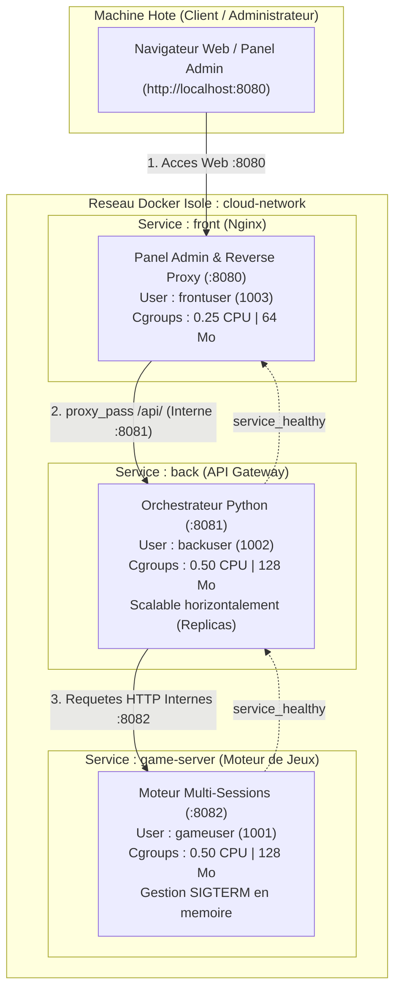

# CloudGame Manager - Architecture Cloud & Supervision Docker

Projet d'infrastructure virtualisee multi-conteneurs pour l'hebergement, l'orchestration et la supervision de serveurs de jeux.

---

## 1. Vue d'Ensemble de l'Architecture

L'application repose sur une architecture 3-tiers conteneurisee, entierement isolee au sein d'un reseau prive Docker :

1. **Front-End (Reverse Proxy Nginx)** : Point d'entree unique du cluster (port public 8080). Il distribue l'interface d'administration web et route de maniere transparente les requetes `/api/` vers les services internes.
2. **Back-End (API Gateway & Orchestrateur)** : Service Python asynchrone qui centralise la logique metier, valide les actions d'administration et communique avec le serveur de jeux. Il est concu pour etre scalable horizontalement.
3. **Serveur de Jeux (Moteur Multi-Sessions)** : Service autonome gerant l'etat des parties (`PixelQuest`, `CyberArena`), le suivi des joueurs actifs et les scores en memoire.

---

## 2. Conception des Images Docker (Choix au Build)

Toutes les images du projet sont construites localement a partir de fichiers `Dockerfile` dedies, sans recours a des images d'application preconfigurees de Docker Hub.

### Distribution de base : Alpine Linux 3.20
* **Taille minimale** : Une empreinte d'environ 7 Mo par couche de base, optimisant le temps de transfert et le cache disque.
* **Securite renforcee** : Surface d'attaque reduite au strict minimum necessaire.
* **Nettoyage systematique** : Purge du cache des paquets a la fin de chaque directive (`rm -rf /var/cache/apk/*`).

### Dependances installees par service
* **Front-End** :
  * `nginx` : Serveur HTTP evenementiel haute performance utilise comme reverse proxy et serveur de fichiers statiques.
  * `curl` : Utilise exclusivement pour l'execution de la sonde de sante (`HEALTHCHECK`).
* **Back-End et Serveur de Jeux** :
  * `python3` : Runtime standard pour executer les scripts de l'API et du moteur sans installer de bibliotheque tierce lourde.
  * `curl` : Utilise pour les sondes `HEALTHCHECK`.

### Securisation de l'OS et principe de moindre privilege
Aucun service ne s'execute avec les privileges de l'utilisateur `root` :
* **game-server** : Execute sous l'identifiant `gameuser` (UID 1001, groupe `gamesquad`).
* **back-api** : Execute sous l'identifiant `backuser` (UID 1002, groupe `backgroup`).
* **front-nginx** : Execute sous l'identifiant `frontuser` (UID 1003, groupe `frontgroup`).
* Tous les comptes utilisateurs sont crees avec un shell desactive (`-s /sbin/nologin`) empechant toute connexion interactive sur le systeme hote.
* Les repertoires necessaires a Nginx (`/var/log/nginx`, `/var/lib/nginx`, `/tmp/client_temp`, etc.) sont prealablement crees et assignes a `frontuser`.

### Gestion des Entrypoints et du PID 1
Les conteneurs utilisent la syntaxe **Exec Form** :
* Front : `ENTRYPOINT ["nginx"]` (avec la directive `daemon off;` dans `nginx.conf`).
* Back : `ENTRYPOINT ["python3", "app.py"]`.
* Serveur de jeux : `ENTRYPOINT ["python3", "server.py"]`.

Cette approche garantit que les processus applicatifs s'executent directement avec le **PID 1**, sans passer par un sous-shell `/bin/sh -c`. Les signaux systeme d'arret envoyes par Docker sont ainsi interceptes instantanement par les processus applicatifs.

---

## 3. Orchestration et Execution (Choix au Run)

### Configuration et isolation des ressources (cgroups)
Chaque conteneur dispose de limites strictes de ressources definies dans le fichier d'orchestration :
* **front** : 0.25 CPU max | 64 Mo RAM (reservation : 0.05 CPU / 32 Mo).
* **back** : 0.50 CPU max | 128 Mo RAM (reservation : 0.10 CPU / 64 Mo).
* **game-server** : 0.50 CPU max | 128 Mo RAM (reservation : 0.10 CPU / 64 Mo).

Ces contraintes garantissent qu'un conteneur ne peut pas monopoliser les ressources de la machine hote en cas de surcharge.

### Gestion des signaux et arret gracieux (Graceful Shutdown)
* **Nginx** : Recoit le signal `STOPSIGNAL SIGQUIT` pour terminer le traitement des requetes en cours avant de fermer proprement ses processus de travail.
* **Services Python** : Enregistrent un gestionnaire POSIX sur le signal `SIGTERM` (`signal.signal(signal.SIGTERM, shutdown_handler)`). A la reception de l'ordre d'arret, le serveur de jeux persiste l'etat des sessions en memoire et libere les sockets avant de quitter avec un code de retour 0.

### Ordonnancement sequentiel et dependances
Le demarrage de l'infrastructure est coordonne par des sondes de sante actives :
1. `game-server` demarre en premier et valide son etat via `/health`.
2. `back` attend que `game-server` soit declare `healthy` avant de s'initialiser.
3. `front` attend que `back` soit `healthy` avant d'ouvrir son port public 8080 aux utilisateurs.

---

## 4. Schema d'Architecture



---

## 5. Deploiement et Utilisation

### Mode 1 : Deploiement Standard (Docker Compose)
Placez-vous dans le dossier `gestionnaire_game_server` :
```bash
# Construction des images
docker compose build

# Lancement des conteneurs
docker compose up -d

# Verification de l'etat des services
docker compose ps
```

### Mode 2 : Deploiement en Cluster Scalable (Docker Swarm)
L'infrastructure permet de multiplier dynamiquement les instances de l'API Back-End derriere le reverse proxy :
```bash
# 1. Initialiser le cluster Swarm
docker swarm init

# 2. Deployer la stack
docker stack deploy -c swarm-stack.yml cloud_game

# 3. Verifier la repartition des 3 replicas du backend
docker stack services cloud_game

# 4. Scaler dynamiquement a 5 instances
docker service scale cloud_game_back=5
```

L'interface web accessible sur `http://localhost:8080` affiche en temps reel quel replica (`worker_node`) a pris en charge chaque requete.

### Verification des limitations de ressources cgroups
```powershell
docker inspect cloud_front_dashboard --format 'Memory={{.HostConfig.Memory}} NanoCpus={{.HostConfig.NanoCPUs}}'
docker inspect cloud_game_server --format 'Memory={{.HostConfig.Memory}} NanoCpus={{.HostConfig.NanoCPUs}}'
```

### Verification de l'arret gracieux (SIGTERM)
```powershell
docker stop cloud_game_server
docker logs cloud_game_server --tail 5
```

### Arret de l'infrastructure
* Avec Compose : `docker compose down`
* Avec Swarm : `docker stack rm cloud_game`
